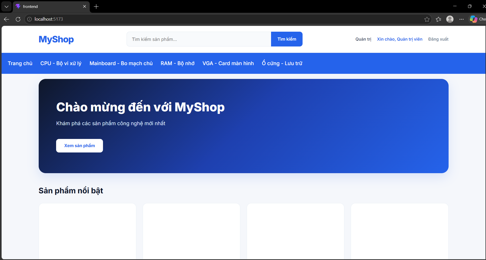
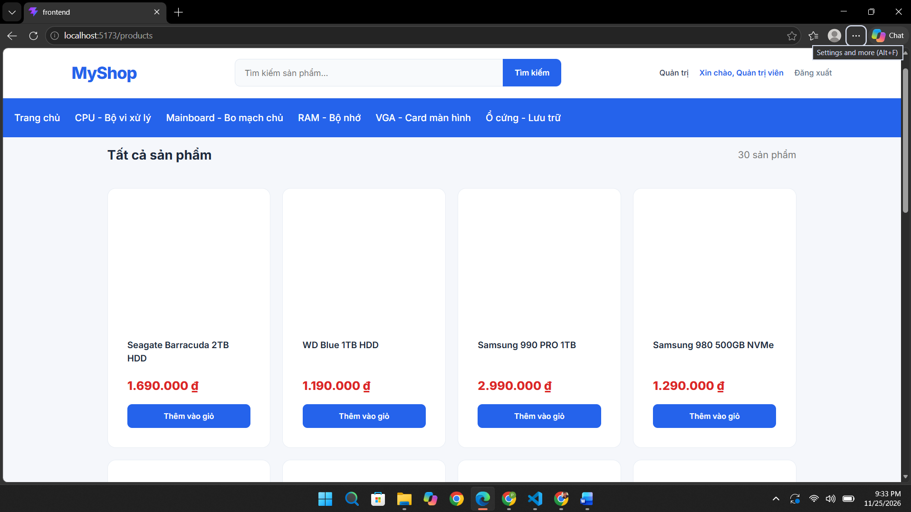
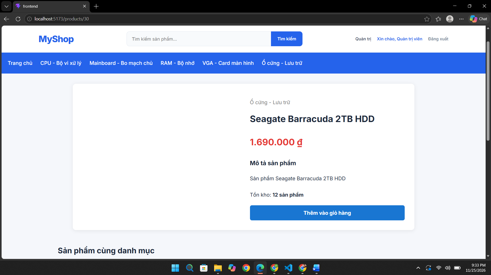
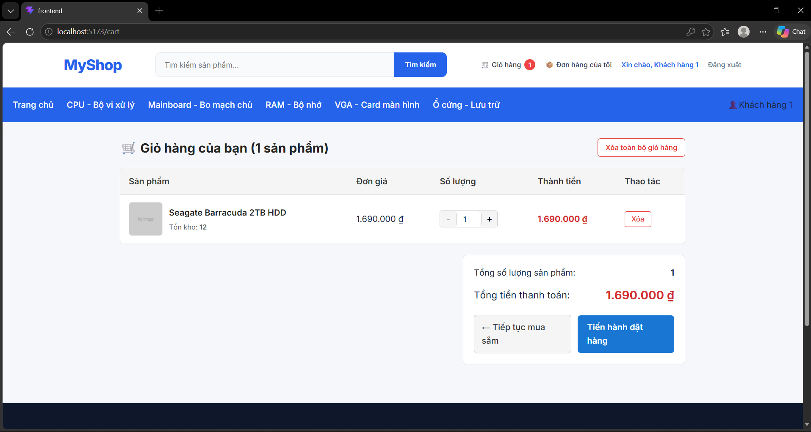
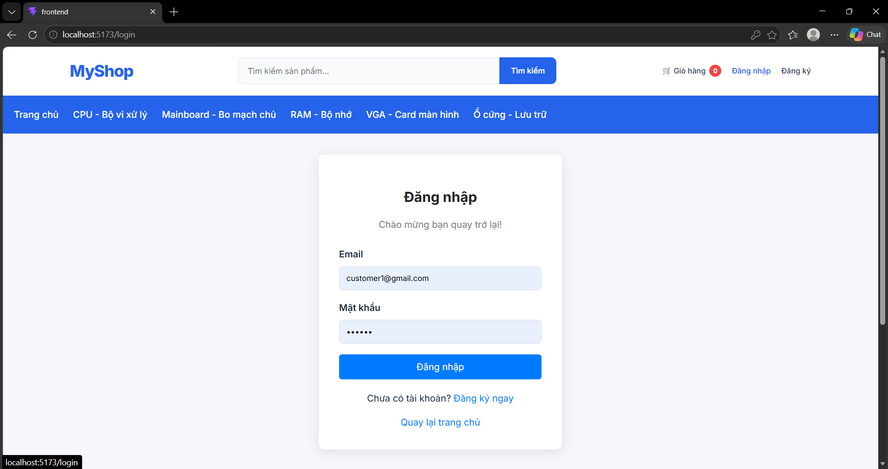
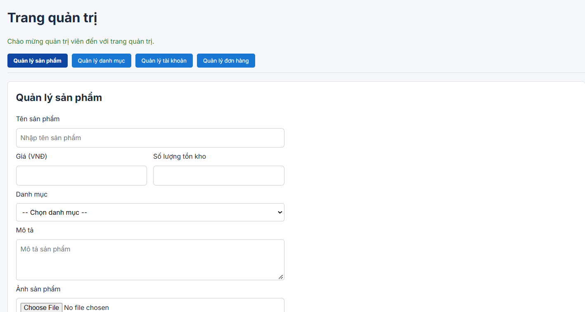
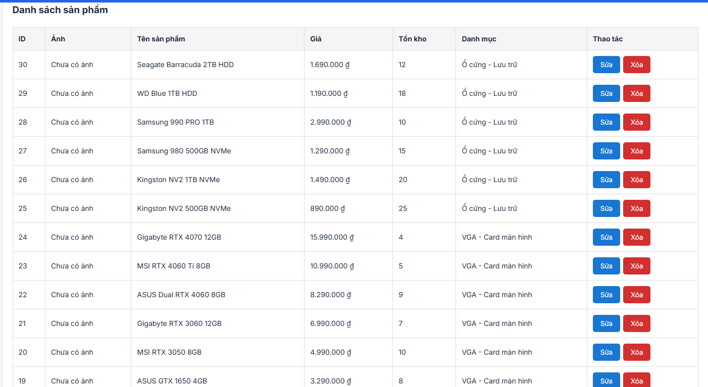

# CHƯƠNG 5. GIAO DIỆN HỆ THỐNG

## 5.1. Giao diện trang chủ

**Mô tả:**

Trang chủ hiển thị banner giới thiệu, thanh điều hướng, danh mục và các sản phẩm nổi bật. Người dùng có thể truy cập nhanh đến các chức năng chính của website.

## 5.2. Giao diện danh sách sản phẩm

**Mô tả:**

Hiển thị danh sách linh kiện máy tính với hình ảnh, tên và giá bán. Người dùng có thể lựa chọn danh mục để xem các sản phẩm tương ứng.

## 5.3. Giao diện chi tiết sản phẩm

**Mô tả:**

Hiển thị thông tin chi tiết của sản phẩm gồm hình ảnh, tên, giá, mô tả và số lượng tồn kho.

## 5.4. Giao diện giỏ hàng

**Mô tả:**

Hiển thị các sản phẩm người dùng đã thêm vào giỏ hàng, số lượng, đơn giá và tổng tiền.

## 5.5. Giao diện đăng nhập và đăng ký

**Mô tả:**

Cho phép người dùng đăng nhập vào hệ thống hoặc tạo tài khoản mới để sử dụng các chức năng mua sắm.

## 5.6. Giao diện quản trị

**Mô tả:**

Giao diện dành cho quản trị viên, hỗ trợ quản lý danh mục và sản phẩm trong hệ thống.