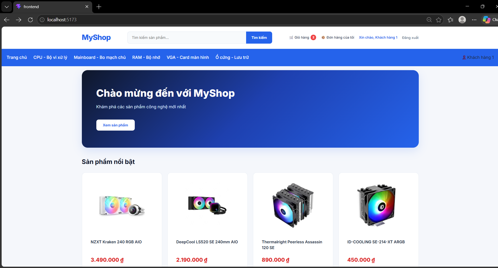
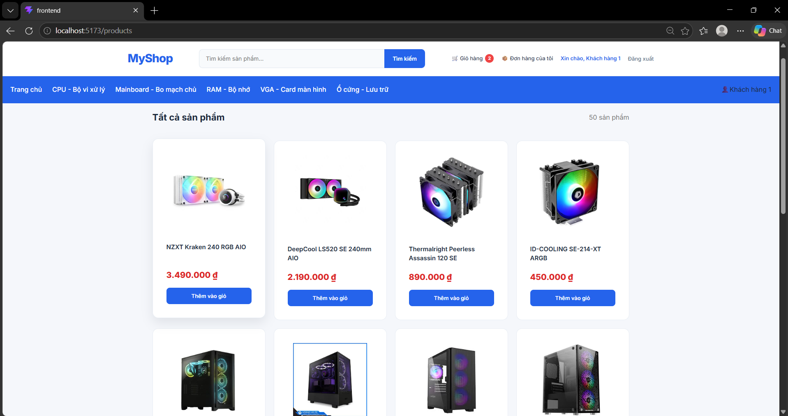
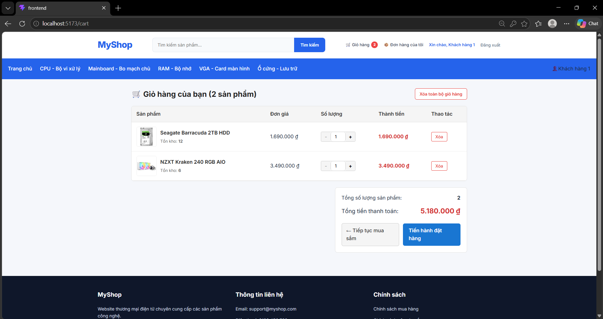
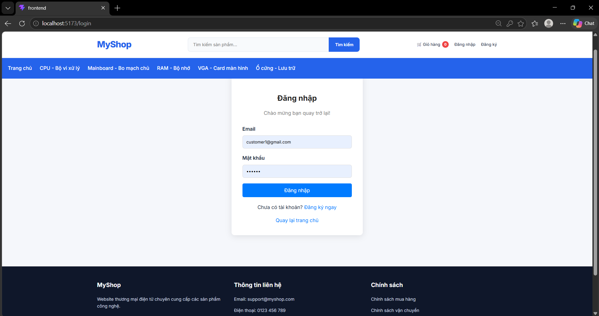
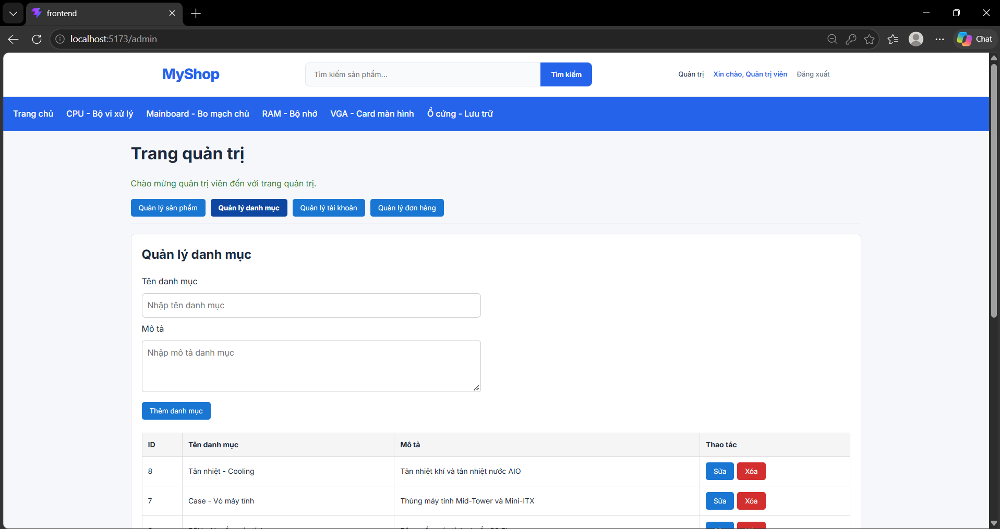
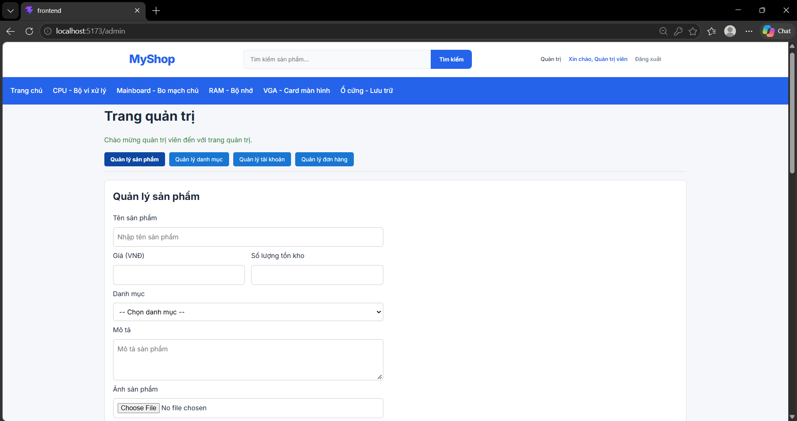
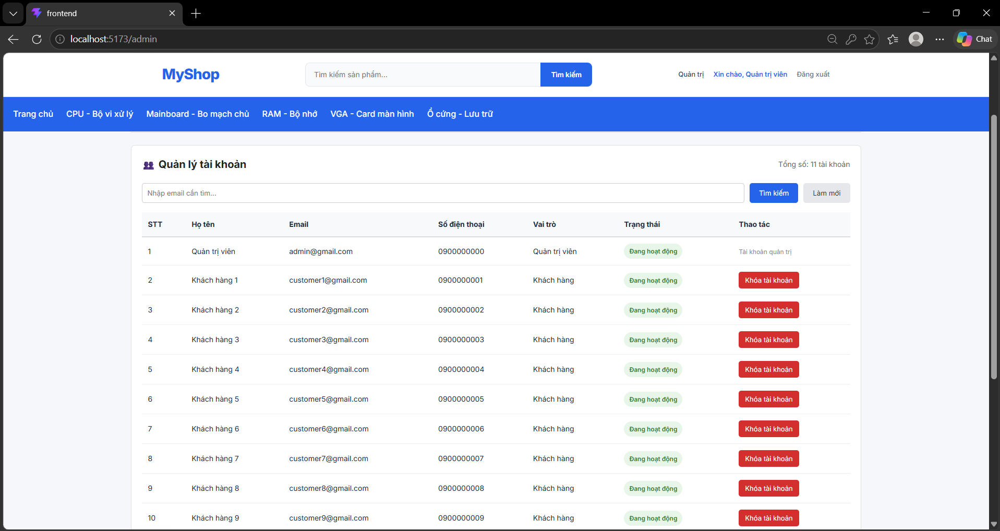
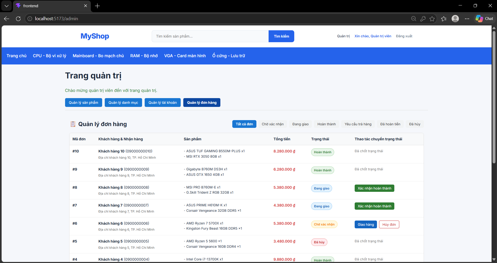

# CHƯƠNG 5. GIAO DIỆN HỆ THỐNG

## 5.1. Giao diện trang chủ

**Mô tả:**

Trang chủ hiển thị banner giới thiệu, thanh điều hướng, danh mục và các sản phẩm nổi bật. Người dùng có thể truy cập nhanh đến các chức năng chính của website.

## 5.2. Giao diện danh sách sản phẩm

**Mô tả:**

Hiển thị danh sách linh kiện máy tính với hình ảnh, tên và giá bán. Người dùng có thể lựa chọn danh mục để xem các sản phẩm tương ứng.

## 5.3. Giao diện chi tiết sản phẩm

**Mô tả:**

Hiển thị thông tin chi tiết của sản phẩm gồm hình ảnh, tên, giá, mô tả và số lượng tồn kho.

## 5.4. Giao diện giỏ hàng

**Mô tả:**

Hiển thị các sản phẩm người dùng đã thêm vào giỏ hàng, số lượng, đơn giá và tổng tiền.

## 5.5. Giao diện đăng nhập và đăng ký

**Mô tả:**

Cho phép người dùng đăng nhập vào hệ thống hoặc tạo tài khoản mới để sử dụng các chức năng mua sắm.

### 5.6. Giao diện quản trị

**Hình 5.xx. Giao diện quản lý danh mục**

**Hình 5.xx. Giao diện quản lý sản phẩm**

**Hình 5.xx. Giao diện quản lý tài khoản**

**Hình 5.xx. Giao diện quản lý đơn hàng**

**Mô tả:**

Giao diện quản trị dành cho quản trị viên, cung cấp các chức năng quản lý và theo dõi hoạt động của hệ thống, bao gồm:

- **Quản lý danh mục:** Hiển thị danh sách danh mục sản phẩm, hỗ trợ thêm, sửa và xóa danh mục.
- **Quản lý sản phẩm:** Hiển thị danh sách sản phẩm, hỗ trợ thêm mới, chỉnh sửa thông tin, cập nhật hình ảnh, giá bán, số lượng tồn kho và xóa sản phẩm.
- **Quản lý tài khoản:** Hiển thị danh sách tài khoản người dùng, hỗ trợ xem thông tin, quản lý và cập nhật trạng thái tài khoản.
- **Quản lý đơn hàng:** Hiển thị danh sách đơn hàng, xem chi tiết đơn hàng và cập nhật trạng thái xử lý đơn hàng.

Giao diện được thiết kế nhằm giúp quản trị viên dễ dàng quản lý dữ liệu, kiểm soát hoạt động kinh doanh và nâng cao hiệu quả vận hành hệ thống MyShop.